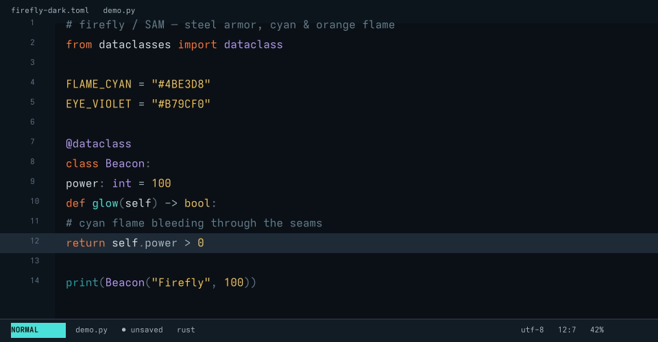
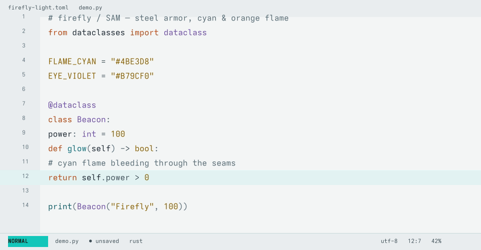

# Firefly for Helix

Two Helix themes inspired by **Firefly / SAM** from *Honkai: Star Rail*: blue-steel armor
grays, cyan and orange-red flame, mech gold, and the cyan-to-violet eye gradient.

| Dark | Light |
| --- | --- |
|  |  |

> The images above are rendered previews of the palettes. Real screenshots from Helix are welcome.

## Install

Copy the themes:

```sh
git clone https://github.com/ZhaoCake/helix-firefly.git
mkdir -p ~/.config/helix/themes
cp helix-firefly/themes/firefly-*.toml ~/.config/helix/themes/
```

Or install just one:

```sh
curl -fsSL https://raw.githubusercontent.com/ZhaoCake/helix-firefly/main/themes/firefly-dark.toml \
  -o ~/.config/helix/themes/firefly-dark.toml
```

Then in `~/.config/helix/config.toml`:

```toml
theme = "firefly-dark"   # or "firefly-light"
```

Switch at runtime with `:theme firefly-light`.

The local script does the copy for you:

```sh
./install.sh
```

## Design

### Armor grays

The SAM armor in the official art is not black: it is cool blue-steel plating with silver
highlights. Both themes use a full ramp instead of a single background color.

| Role | Dark | Light |
| --- | --- | --- |
| editor background | `#0B1116` | `#F4F7F7` |
| gutter / ruler | `#0F161D` | `#EAEFEF` |
| panels / statusline | `#141D25` | `#EAEFEF` |
| popups / menus | `#1A242E` | `#FFFFFF` |
| cursor line | `#202C37` | `#E4F3F2` |
| borders | `#33434F` | `#CBD7D8` |
| line numbers | `#5E7382` | `#60727C` |
| secondary text | `#A9BAC4` | `#3E4E56` |
| primary text | `#D6E0E4` | `#1B2730` |

### Flame semantics

The same semantic mapping is used in both variants:

| Token class | Color | Meaning |
| --- | --- | --- |
| keywords, tags, headings | orange flame | the structure of the code |
| functions, namespaces, escapes | cyan flame | motion / callables |
| types, macros, attributes, regex | eye violet | the abstract layer |
| strings, numbers, booleans, constants | mech gold | literals |
| comments | blue-gray green | background layer |
| additions / success | wing green | only in diffs |

Statusline modes use the eye gradient: Normal cyan, Insert orange, Select violet.

### Contrast

WCAG contrast against the editor background:

| | dark | light |
| --- | --- | --- |
| primary text | 14.14 | 14.13 |
| secondary text | 9.50 | 8.03 |
| comments | 4.62 | 5.20 |
| keywords | 7.31 | 4.97 |
| functions | 12.01 | 5.53 |
| types | 8.16 | 5.85 |
| strings | 11.75 | 5.14 |
| errors | 6.23 | 6.07 |

## Palette

### firefly-dark

```
steel_900 #0B1116   steel_850 #0F161D   steel_800 #141D25   steel_750 #1A242E
steel_700 #202C37   steel_650 #283745   steel_600 #33434F   steel_500 #455967
steel_400 #5E7382   steel_300 #7E929F   steel_200 #A9BAC4   steel_100 #D6E0E4
flame_cyan #4BE3D8  flame_cyan_deep #1FA6A8  flame_orange #FF7A33  flame_red #FF5C4D
mech_gold #F5C552   eye_violet #B79CF0  wing_green #5FD3A6
```

### firefly-light

```
steel_050 #FFFFFF   steel_100 #F4F7F7   steel_150 #EAEFEF   steel_200 #DFE7E7
steel_300 #CBD7D8   steel_400 #B0C0C3   steel_600 #73878D   steel_700 #60727C
steel_800 #3E4E56   steel_900 #1B2730
flame_cyan #14C8BC  flame_orange #FF7A33  mech_gold #F5C552  eye_violet #A78BFA
cyan_ink #0B6E7A    cyan_ink_deep #0A5A63  orange_ink #B8460E  red_ink #B3261E
gold_ink #8A6100    violet_ink #6D4FA8     green_ink #1E7A57
```

## Validating

```sh
python3 scripts/check.py
```

The script checks TOML parsing, palette references, dark/light scope parity and the
contrast of visible text scopes. CI runs it on every push.

If you plan to submit upstream, Helix also ships a stricter checker:

```sh
cargo xtask theme-check
```

Note that as of 2026 the Helix maintainers are not accepting new built-in themes
([discussion #15346](https://github.com/helix-editor/helix/discussions/15346)).
Distribution is via this repository and the
[Helix wiki theme list](https://github.com/helix-editor/helix/wiki/Themes).

## 中文简介

流萤 / 萨姆配色的 Helix 主题，深浅两套。灰阶取自机甲装甲的蓝钢与银白，强调色分别对应
青焰、橙焰、机甲黄和眼瞳紫。安装后设置 `theme = "firefly-dark"` 或 `"firefly-light"` 即可。

## License

MIT. See [LICENSE](LICENSE).

This is an unofficial fan-made color theme. It is not affiliated with or endorsed by
HoYoverse. *Honkai: Star Rail*, Firefly and SAM are trademarks of their respective owners;
only color inspiration is used here.
